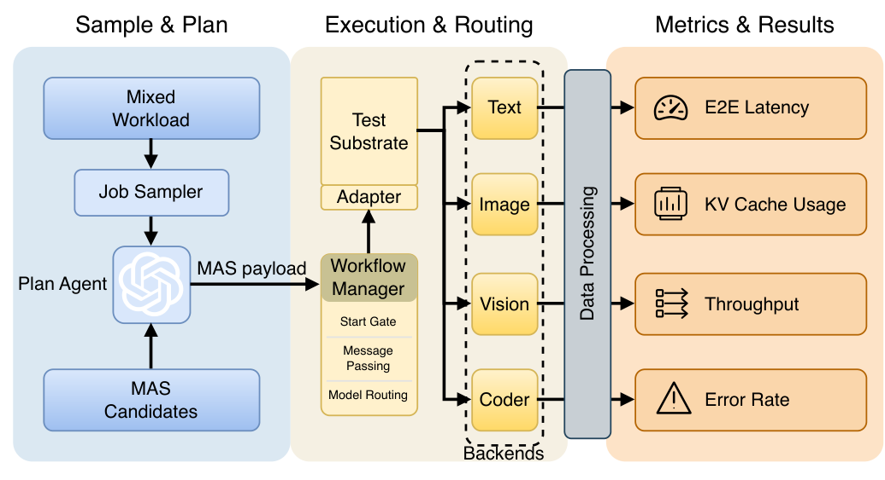

# MAS-Sys

**The Evaluation Substrate Matters: Benchmarking Multi-Agent Serving Substrates**

Paper · Website · [Traces](https://huggingface.co/datasets/MAS-Sys/MAS-Sys-Traces)

## Overview

MAS-Sys benchmarks how serving substrates and offered load affect multi-agent
systems. It replays the same candidate–task pairs across serving conditions and
records task quality alongside delivery, latency, cost, resource pressure, and
failure evidence. This repository contains the benchmark code and serving
integrations.

## Benchmark Construction



**MAS-Sys Evaluation Architecture:** prepare a mixed workload, freeze its arrival
plan and MAS execution plans, then replay it across serving substrates while
recording system behavior and task outcomes.

**Reproducibility.** For controlled comparisons across serving substrates, reuse the same prepared workload directory. This keeps job arrivals, task assignments, MAS topologies, prompts, model assignments, and tool configurations fixed, isolating changes in the serving environment. Task-quality evaluation is separate from execution success.

## Getting Started

Run commands from the repository root. Local serving requires compatible NVIDIA
GPUs and CUDA; SWE-bench and sandboxed tools require working Docker access
(`docker info`).

### Installation

```bash
conda create -n mas-sys python=3.11 -y
conda activate mas-sys
pip install -r requirements.txt
python -m playwright install chromium
export PYTHONPATH="$PWD:$PYTHONPATH"
```

### Backend Setup

Install only the backends you need, in the environment names expected by
`serving/serve.py`.

<details>
<summary>Backend installation commands</summary>

**vLLM / Continuum** (`mas-vllm`): Continuum overlays the bundled fork at launch.

```bash
conda create -n mas-vllm python=3.11 -y
conda activate mas-vllm
pip install -e ./serving/vllm
# Additionally required for Continuum:
pip install lmcache hf_transfer
```

**SGLang** (`mas-sglang`):

```bash
conda create -n mas-sglang python=3.11 -y
conda activate mas-sglang
pip install -e "./serving/sglang/python[all]"
# For image serving:
pip install -e "./serving/sglang/python[diffusion]"
```

**vLLM-Omni** (`mas-vllm-omni`):

```bash
conda create -n mas-vllm-omni python=3.11 -y
conda activate mas-vllm-omni
pip install -e ./serving/vllm-omni
```

**ORLA** runs as a separate scheduler daemon:

```bash
mkdir -p ~/.local/bin
curl -L https://github.com/harvard-cns/orla/releases/download/v1.2.15/orla-linux-amd64.tar.gz \
  -o /tmp/orla-linux-amd64.tar.gz
tar -xzf /tmp/orla-linux-amd64.tar.gz -C /tmp
install /tmp/orla ~/.local/bin/orla
~/.local/bin/orla --version
```

</details>

### Configuration

Return to the benchmark environment and copy the configuration template:

```bash
conda activate mas-sys
cp config/config.example.toml config/config.toml
```

Edit the ignored `config/config.toml` to set planner endpoints, model candidates,
backend names, model paths, ports, GPU assignments, and required API/tool
credentials. Set the seed, arrival-window duration, target JPS, and workload mix
in [example.yaml](experiments/MixedWorkloadBench/configs/example.yaml).

## Running the Benchmark

### Start Model Backends

```bash
python serving/serve.py start --all
python serving/serve.py status
```

For ORLA experiments, start its daemon **before** starting model backends:

```bash
mkdir -p serving/logs
nohup ~/.local/bin/orla serve --listen-address 127.0.0.1:8081 --pretty \
  > serving/logs/orla.log 2>&1 &
curl -s http://127.0.0.1:8081/api/v1/backends
```

### Prepare and Replay

Prepare arrivals and MAS plans without executing jobs:

```bash
python experiments/MixedWorkloadBench/run_mixed_workload.py \
  --config experiments/MixedWorkloadBench/configs/example.yaml --prepare-only
```

Replay using the `prepare_dir` printed above (replace `prepare_N`):

```bash
python experiments/MixedWorkloadBench/run_mixed_workload.py \
  --config experiments/MixedWorkloadBench/configs/example.yaml \
  --prepared-workload experiments/MixedWorkloadBench/prepare/prepare_N
```

Reuse this directory across serving conditions; add `--runtime orla` for ORLA.
If `--prepared-workload` is omitted, the runner finds a matching prepared workload
or creates one. SWE-bench Docker images are prepared before the pressure window.

### Outputs

Run artifacts are saved under
`experiments/MixedWorkloadBench/results/mixed_workload_<timestamp>/`, including
configuration snapshots, job traces, resource/health samples, and evaluations.
Aggregate metrics are appended to `experiments/MixedWorkloadBench/summary.csv`.

Stop model backends when finished:

```bash
python serving/serve.py stop --all
```

## Individual Benchmarks

<details>
<summary>Example commands for the five workload families</summary>

```bash
# ResearchBench
python -m experiments.ResearchBench.run_proposal_eval --input medium
python -m experiments.ResearchBench.run_review_eval --input review

# SWE-bench
python -m experiments.SWEBench.run_swebench --end 5

# PinchBench
python -m experiments.PinchBench.run_pinchbench \
  --task_ids task_00_sanity task_01_calendar

# PaperBananaBench
python experiments/PaperBananaBench/run_benchmark.py \
  --task_name diagram --split_name test --max_samples 3

# DeepFundBench
python -m experiments.DeepFundBench.run_deepfund \
  --config experiments/DeepFundBench/configs/dev.yaml
```

</details>

## Citation

Citation information will be added when the paper is released.

## License and Acknowledgments

MAS-Sys code, scripts, configuration files, and documentation are released under
the [Apache License 2.0](LICENSE). Bundled third-party serving components retain
their original Apache-2.0 licenses: vLLM, Continuum, SGLang (including sgl-kernel
and sgl-model-gateway), and vLLM-Omni (including ComfyUI-vLLM-Omni).

The external ORLA daemon and SDK retain their upstream MIT license; MAS-Sys
integration/client code is covered by this repository's license. Third-party
datasets retain their original licenses; see [DATA_SOURCES.md](DATA_SOURCES.md).
